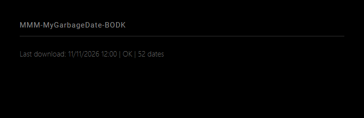

# MMM-MyGarbageDate-BODK

## Description

A MagicMirror² module that downloads the Waste2x PDF calendar and converts vector icons to CSV for MMM-MyGarbage-BODK.

The mirror displays only one status line:

```text
Last download: 04/11/2026 21:45 | OK | 93 dates
```

The timestamp records when the PDF finished downloading, in the mirror browser's local timezone (DD/MM/YYYY HH:mm). OK confirms successful parsing and CSV replacement. The count represents distinct collection dates.

### Preview

Successful download status using a fictional timestamp and date count. This module generates the CSV; collection pictograms are displayed by MMM-MyGarbage-BODK. English is the default language.



The [browser preview](docs/preview.html) uses fictional data only; it does not validate external services or hardware.

## Requirements

A working MagicMirror² installation and a Node.js version supported by that installation.

Python 3, access to the configured Waste2x service and the supported HTK PDF calendar layout are required. Install MMM-MyGarbage-BODK separately to display the resulting collections.

Python 3 with venv and pip support must be installed first. On Raspberry Pi OS:

```sh
sudo apt install python3-venv python3-pip
```

`npm install` creates a module-local `.venv` and installs `requirements.txt`. Set `PYTHON` to another Python executable during installation if needed. npm does not install operating-system packages.

## Installation

Run these commands on the device running MagicMirror²:

```sh
cd ~/MagicMirror/modules
git clone https://github.com/BravoOscarDK/MMM-MyGarbageDate-BODK.git
cd MMM-MyGarbageDate-BODK
npm install
```

Keep the folder name `MMM-MyGarbageDate-BODK` unchanged. Complete the configuration below, then restart MagicMirror² using your usual startup method.

## Configuration

Add this entry to the `modules` array in `~/MagicMirror/config/config.js`:

```js
{
  module: "MMM-MyGarbageDate-BODK",
  position: "bottom_left",
  config: {
    language: "en",
    address: "Example Street 123",
    postalCode: "0000",
    outputFile: "../MMM-MyGarbage-BODK/garbage_schedule.csv"
  }
}
```

A position is required to display status. Remove any previous showStatus: false setting or change it to true. Configure MMM-MyGarbage-BODK separately if you also want to display upcoming collections.

The address and postal code above are fictional placeholders. Replace both with your own address and postal code in your local MagicMirror² configuration before starting the module. The module has no built-in personal address.

| Option | Default | Description |
| --- | --- | --- |
| `language` | `"en"` | Display language: English (`en`) or Danish (`da`). |
| `pythonPath` | `""` (module `.venv`) | Python executable or absolute path; no shell arguments. |
| `address` | `""` | Required: exact street name and house number. |
| `postalCode` | `""` | Required: your four-digit postal code as a string. |
| `expectedAddress` | `""` | Optional additional PDF text check. The matched location is always checked automatically. |
| `organizationId` | `464debc4-4de1-4bc7-bd45-614c8eca81e9` | Waste2x organization ID. |
| `year` | `null` | Automatic current year, recalculated on every update. Omit this option, use null or "auto". A number selects a fixed year for manual use. |
| `outputFile` | `../MMM-MyGarbage-BODK/garbage_schedule.csv` | Absolute path or path relative to this module. Missing parent directories are created. |
| `updateInterval` | `86400000` | Milliseconds between updates; default 24 hours, minimum one minute. |
| `showStatus` | `true` | Display download time, success status and date count. |

Downloads run at startup and at each interval. Failed updates retain the last successful timestamp and count and append "Latest update failed". Without a successful download in the current session, errors display "Calendar download failed". Details are logged on the server. Status is not persisted across restarts; restarting triggers a fresh download.

The collection display module reads its CSV hourly, so updated collections may take up to one hour to appear.

### Address lookup

Set your street name, house number and postal code in the configuration shown above. For example:

```js
address: "Example Street 123",
postalCode: "0000"
```

These are fictional examples; enter your actual details locally. The module automatically finds the Waste2x customer ID from address and postalCode on every update. No addressId setting is needed or used; remove it from older configurations. Both address and postalCode must be configured. Postal codes must be four-digit strings.

Address lookup requires one exact match and verifies the matched location against the PDF before replacing the CSV. Ambiguous or missing matches and PDF address mismatches fail the update and preserve the existing CSV. An optional expectedAddress adds another check and cannot disable the automatic check. The default organizationId belongs to HTK Waste2x; this is not a generic calendar parser for other municipalities.

CSV dates use MM/DD/YY and values use 0/1. Dates are sorted and waste types on the same date are merged. Existing column names remain unchanged for compatibility:

```csv
WeekStarting,Farligt,Have,Stor,Pap,Papir,Plast,Drikke,Glas,Metal,Rest,Mad
```

### Automatic year changes

The example configuration uses the current year automatically. Remove any old year: 2026 entry from your configuration. At the first update in a new year, the server requests that year's PDF. The module schedules an additional update at January 1 midnight in the mirror browser's local timezone; keep the mirror and server timezones aligned. No annual configuration edit or restart is required.

If the new calendar is unavailable, the update fails visibly, the existing CSV is preserved, and the module retries at its normal update interval. The previous year's dates are never relabeled as the new year. Only one year's calendar is written at a time.

The live 2026 calendar has been verified. At the November 2026 development check, Waste2x returned HTTP 400 for 2027 and 2028, so those real calendars could not yet be verified. Future calendars work with the supported PDF layout; a redesigned PDF may require a parser update.

Download and parsing errors preserve the existing CSV. A successful conversion atomically replaces the entire CSV with the selected year's calendar. Back up any manually edited schedule before enabling automatic updates.

### CSV retention

The CSV writer enforces a maximum of two calendar years: the selected year and the preceding year. In automatic mode, this means the current year and the previous year. For example, in 2028 only dates from 2027 and 2028 can be written. Older dates and dates beyond the selected year are discarded before replacement. Duplicate dates are removed and rows are sorted; the status count reflects the rows actually written.

Currently each download supplies one year's calendar, and the CSV is replaced rather than appended. It therefore normally contains only that year. The two-year limit also prevents growth if multiple years are supplied to the writer in the future. No calendar history is accumulated in separate files. Cleanup happens on successful updates; a failed update preserves the last working CSV.

## Language

English is the default, independently of the MagicMirror² global language. Set the language in this module's `config`:

```js
language: "en" // English (default); use "da" for Danish.
```

Unsupported languages fall back to English. Custom labels, device names and upstream data retain their configured or reported values. Technical logs and diagnostic errors are in English.

## Updating

For an installation created with `git clone`:

```sh
cd ~/MagicMirror/modules/MMM-MyGarbageDate-BODK
git pull --ff-only
npm install
```

Restart MagicMirror² using your usual startup method. Keep your module settings in `~/MagicMirror/config/config.js`. If Git reports local changes or diverging branches, preserve those changes and resolve the issue before updating. A ZIP download or copied folder must be replaced manually or migrated to a Git clone before using `git pull`.

## Troubleshooting

The parser follows the supplied HTK Waste2x 2026 layout: two landscape A4 pages, six months per page, fixed icon coordinates and six known colors. Original color combinations are preserved. The hazardous waste column remains zero because no corresponding color was supplied.

The date calculations support different years, including leap years. The printed year on both PDF pages must match the requested year. Check results against the original PDF, especially if Waste2x changes its layout or colors. Unexpected page dimensions, page counts, year labels, invalid dates, fewer than 30 collection dates or missing garden waste cause errors. These checks cannot detect every layout or legend change.

Failed downloads preserve the existing CSV. Check the server log, address, postal code, Python environment and original PDF before retrying.

## Validation

```sh
npm test
npm run check
```

Automated tests do not establish hardware compatibility. Verify the module on your own MagicMirror² installation.

This checks JavaScript syntax. The integrated parser, address matching, CSV replacement and status display were also checked during development. Development test files and prototype converters are not included in the runtime module. Verify the output against the original PDF and check the status on a running MagicMirror² installation.

## License

MIT. See [LICENSE](LICENSE) for license terms and attribution.
